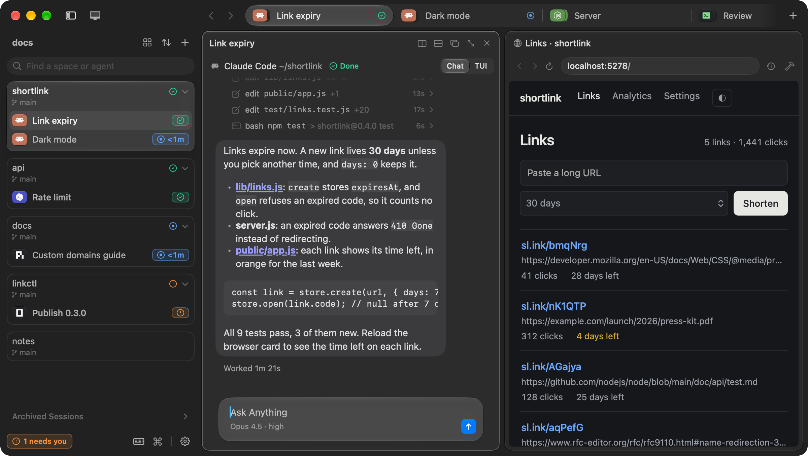

# Ovvi

[](https://skills.sh/hkandala/ovvi)



Ovvi is a native macOS app for [herdr](https://github.com/herdrdev/herdr), the terminal multiplexer for AI
coding agents. herdr keeps the spaces, tabs and panes; Ovvi shows them as live terminal cards in a
Liquid Glass window, on This Mac and on remote machines over SSH. It adds a chat view for agents, browser,
File Explorer and Git cards, and plugins. Everything it does: [the docs](https://ovvi.dev/docs).

## Requirements

- macOS 26 or later, on Apple silicon.
- herdr 0.9.3 or later on each machine. The Mac needs it only for its own sessions.
- Perl on remote machines (the SSH relay is a small Perl script).

## Install

```sh
curl -fsSL https://github.com/hkandala/ovvi/releases/latest/download/install.sh | sh
```

Add `-s -- --version 0.1.0` after `sh` for one release. The script checks the download, installs Ovvi in
`/Applications`, asks before it installs herdr and its agent integrations, and opens Ovvi. Ovvi is not notarized: a
zip that you download in a browser opens only after System Settings ▸ Privacy & Security ▸ Open Anyway. The script
needs no such step. When a new release is out, Ovvi shows a notice, and it installs the update only when you say so.
Details: [Install](https://ovvi.dev/docs#install).

## The ovvi skill

The `ovvi` skill teaches agents the `ovvi` command, which opens cards, floats panes and sends notifications from
a pane. `install.sh` asks before it links the skill for Claude Code, Codex, Pi and OpenCode. For other agents, or
on a remote machine:

```sh
npx skills add hkandala/ovvi -g
```

## Build from source

You need Xcode 27 and Homebrew.

```sh
make setup      # SwiftFormat, SwiftLint, xcbeautify and Node from the Brewfile, and the git hooks
make install    # Ovvi Dev: this checkout as a second app beside Ovvi, in ~/Applications
make run        # a Debug build (SESSION=<name> for one session)
make format     # SwiftLint's fixes and SwiftFormat
make lint build test   # the checks, the build, the unit tests and the repository's own checks
make vm-e2e ONLY=…     # UI tests in the Tart VM ovvi-test, which you make first (playbook/ci.md#the-vm)
```

Ovvi Dev has its own name, settings and icon, and it gets no updates: run `git pull && make install` again.
`make install` also links the `ovvi` skill to the checkout's `skills/ovvi`, unless a skill is already there.
Pass `DERIVED_DATA=/tmp/ovvi-dd-<name>` when several checkouts build at once. Releases:
[RELEASING.md](RELEASING.md).

## Docs

The user docs are in [`docs/content/docs/`](docs/content/docs/), published at
[ovvi.dev/docs](https://ovvi.dev/docs). To run them, you need Node 22 and pnpm 10:
`cd docs && pnpm install && pnpm dev`.
How Ovvi is built, for agents: [`playbook/`](playbook/README.md).

## License

Copyright © 2026 Harish Kandala. Ovvi is free software under the GNU Affero General Public License v3.0 only
(`AGPL-3.0-only`): see [LICENSE](LICENSE). The plugin API's types (`web/ovvi`) and the plugin template
(`plugins/builtin/template`) are MIT, so plugins you write can use any license. The third-party licenses are in
[`Ovvi/Acknowledgements.txt`](Ovvi/Acknowledgements.txt).
